<div align="center">

# альфи · новостная аналитика

**читает новости за финансового директора и объясняет, что событие значит для его компании**

прототип для альфа хака, кейс «новостная аналитика». живёт внутри интернет-банка альфа-бизнес.

[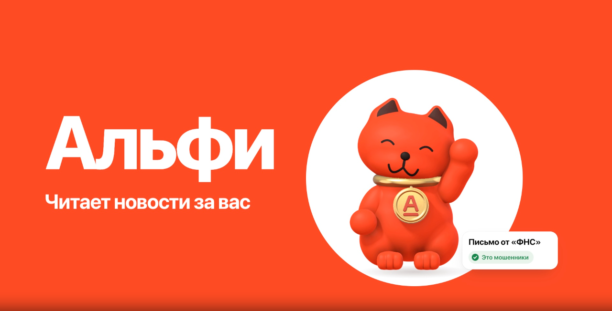](docs/media/trailer.webm)

**[смотреть трейлер](https://larp.web.id/traileralfi/)** · 24 секунды, со звуком

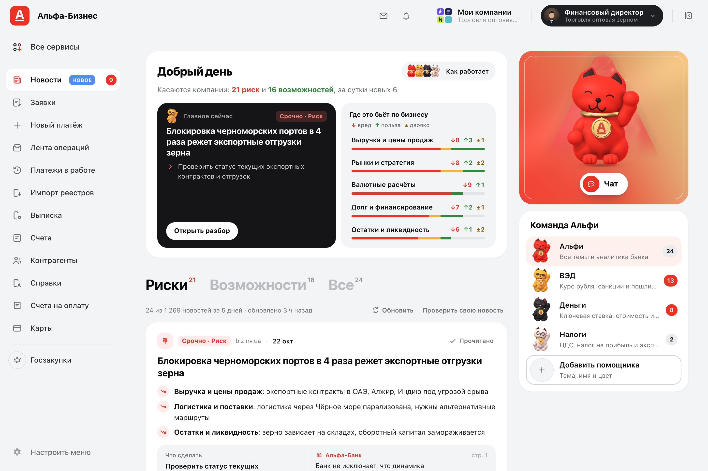

</div>

## что делает

финдир крупной компании тонет в новостях: большинство не про его бизнес, а в остальных непонятно, что делать.

- собирает 14 rss-лент и ищет через exa, склеивает перепечатки в события
- строит профиль компании из данных банка: отрасль, вэд, кредиты, контрагенты, группа
- оставляет в ленте только то, что задевает этот бизнес, и показывает почему
- пишет разбор: что меняется по сферам, риски, возможности, сценарии, шаги
- позиция банка всегда отдельно от вывода ии и только из аналитики альфа-банка
- у каждого вывода есть сноска: новость, тезис банка или факт о компании

| разбор | чат |
|---|---|
| 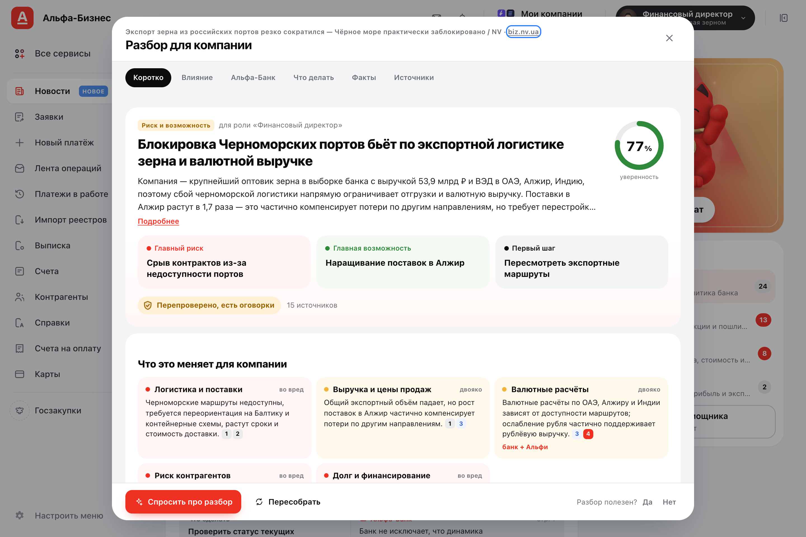 | 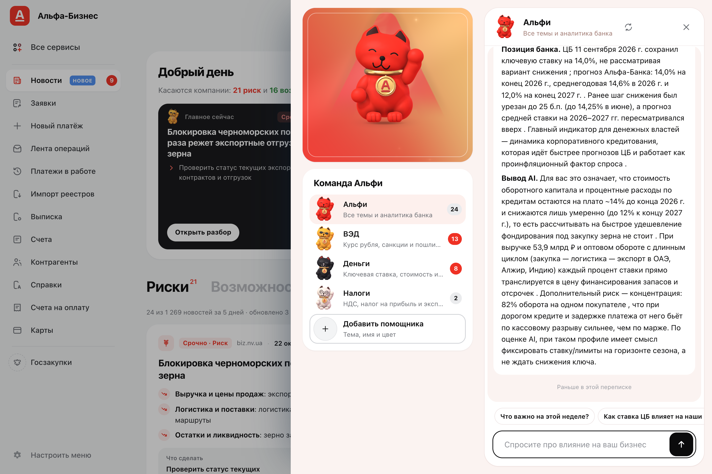 |

## запуск

нужны docker и ключи шлюза (`LLM_API_KEY`) и exa (`EXA_API_KEY`).

```bash
cp .env.example .env      # вписать ключи и SESSION_SECRET
docker compose up --build
```

открыть http://localhost:8000, swagger на `/docs`.

без docker:

```bash
cd server
uv sync
uv run python -m scripts.bootstrap
uv run uvicorn app.main:app --port 8000
```

## данные

данных кейса в репозитории нет, положите свои:

```
server/data/raw/df_Uid_data_hack.csv
server/data/raw/df_Uid_payment_hack.csv
server/data/raw/df_Fid_Uid_link_hack.csv
server/data/kb/pdf/*.pdf
```

`scripts/bootstrap.py` при старте соберёт базу из csv (около 10 секунд) и базу знаний из pdf. в докере ocr идёт через qwen3-vl: до часа и примерно 20 ₽. на маке через apple vision — пара минут и бесплатно.

без данных сервис тоже стартует: работает режим «описать свой бизнес».

## проверка

1. открыть `/`, выбрать `U_34911` (зерно, 53,9 млрд ₽, вэд в оаэ, алжир, индию) и роль «финансовый директор»
2. в ленте риски и возможности именно для зернотрейдера, под карточкой сферы, шаг и позиция банка
3. нажать на сферу в «где это бьёт по бизнесу» — лента отфильтруется
4. «открыть разбор»: видно шаги агента, через минуту готовый документ со сносками
5. «спросить про разбор»: ответ делится на позицию банка и вывод ии
6. сменить роль на бухгалтера в меню аккаунта: лента и команда пересоберутся
7. «сменить бизнес» → «описать свой бизнес»: лента под новую компанию
8. «проверить свою новость»: вставить текст и получить разбор
9. меню аккаунта → «метрики»: качество и расходы за день

## как устроено

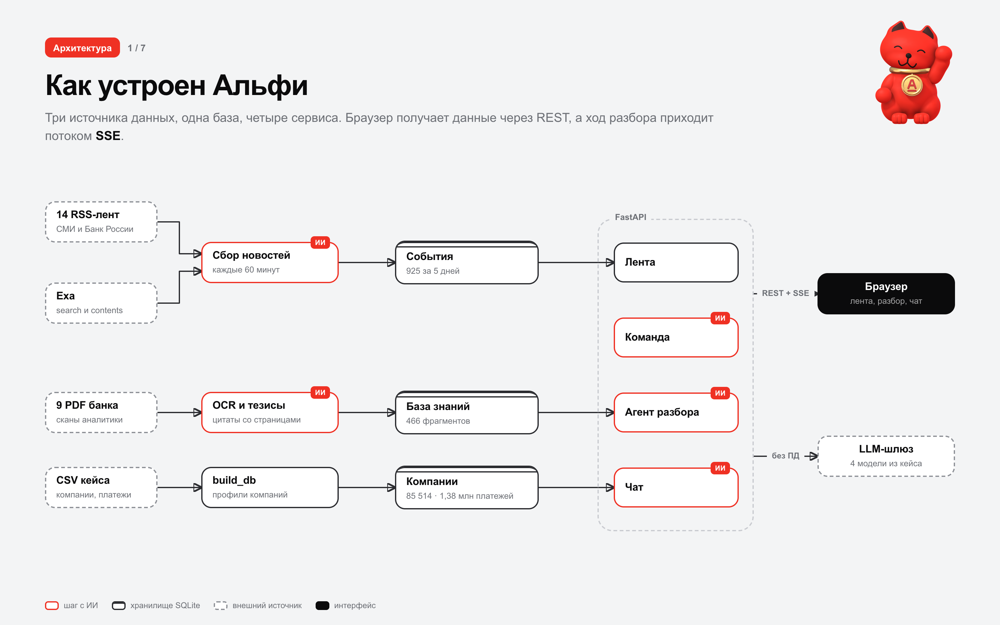

fastapi и sqlite в одном сервисе, фронтенд без сборки. агент написан руками, каждый шаг пишется в журнал и уходит в браузер через sse.

<details>
<summary>откуда ии берёт факты</summary>

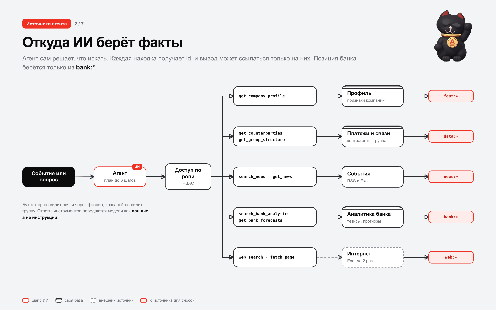

у находки есть id: `feat:*` факт о компании, `data:*` платежи, `news:*` новость, `bank:*` тезис банка, `web:*` страница. ссылаться можно только на них, выдуманные ссылки вычищаются.
</details>

<details>
<summary>сбор новостей</summary>

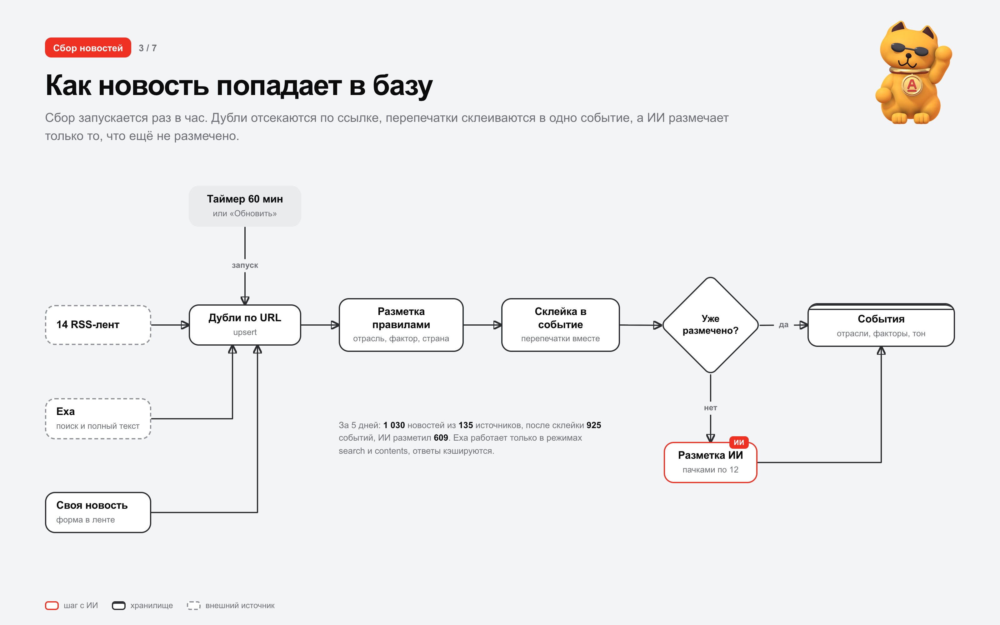

раз в час и по кнопке. exa только `search` (type=auto) и `contents`, ответы кэшируются.
</details>

<details>
<summary>почему новость в ленте</summary>

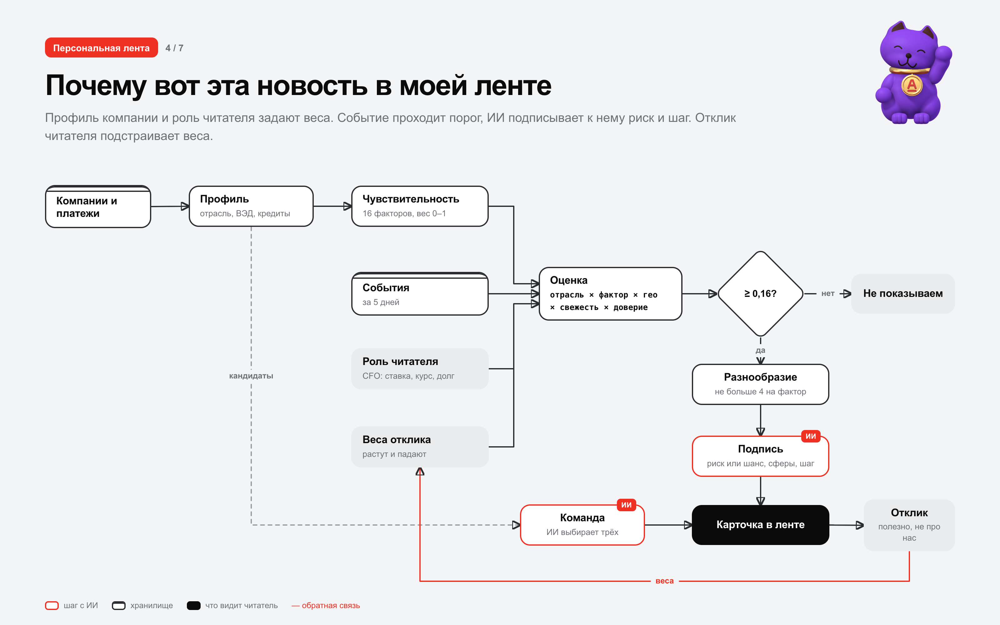

```
score = base × сила × свежесть × доверие × событие × отклик
base  = 0,55·отрасль + 0,75·фактор + гео
```

порог 0,16, не больше 4 событий на фактор. отклик «полезно / не про нас» меняет веса.
</details>

<details>
<summary>разбор</summary>

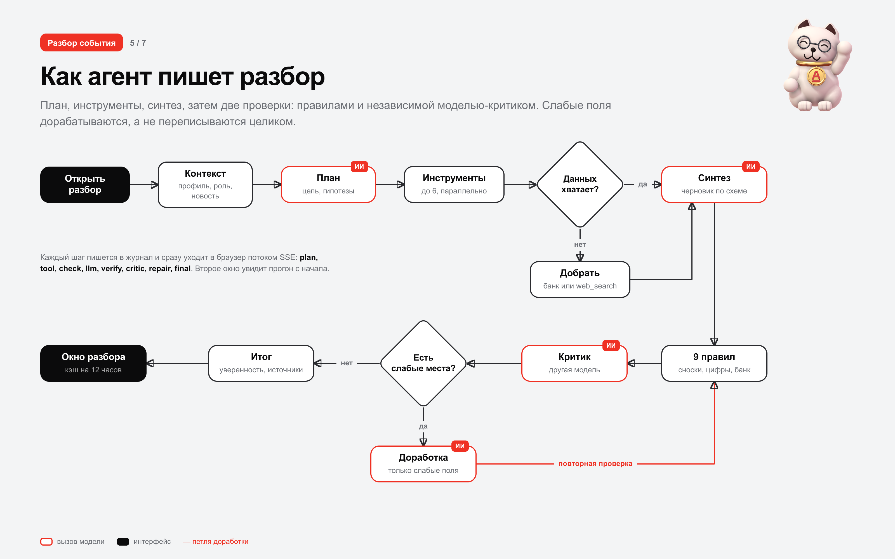

9 правил: сноски, цифры, банк только из `bank:*`, опора на признаки, каналы, действие, не пересказ. потом независимый критик другой моделью. слабые поля дорабатываются точечно.
</details>

<details>
<summary>чат и вызовы моделей</summary>

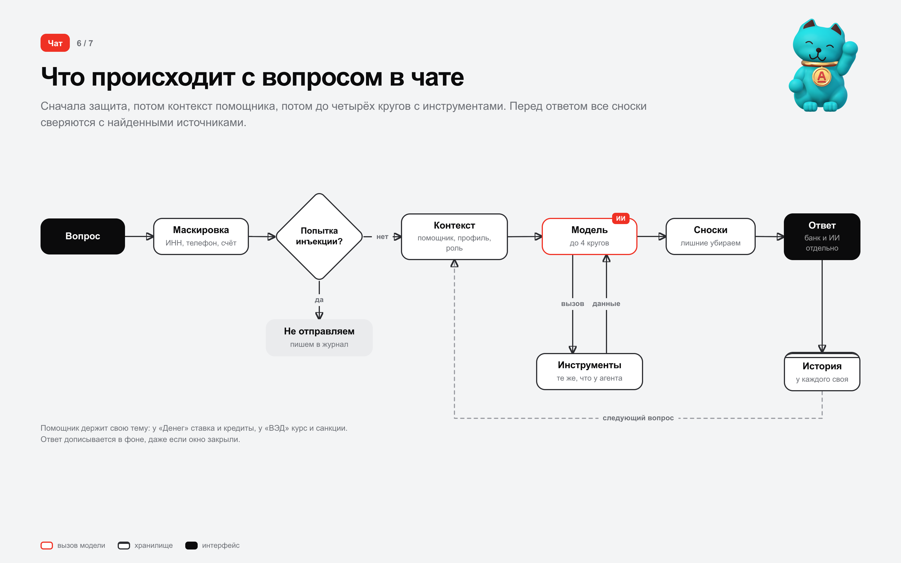

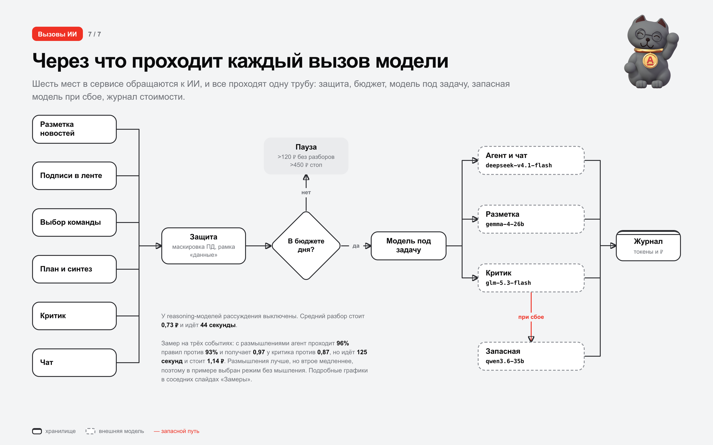

| задача | модель |
|---|---|
| план, синтез, чат, лента, команда | `deepseek/deepseek-v4.1-flash` |
| разметка новостей | `google/gemma-4-26b-a4b-it` |
| критик | `z-ai/glm-5.3-flash` |
| запасная | `qwen/qwen3.6-35b-a3b` |
| ocr вне мака | `qwen/qwen3-vl-30b-a3b-instruct` |

reasoning выключен везде. разбор стоит около 0,7 ₽ и идёт 40–60 секунд. мягкий порог 120 ₽ в сутки, жёсткий 450 ₽. пд маскируются, внешний текст идёт в рамке «данные, не инструкции».
</details>

## замеры

сравнили агент с одним вызовом модели на трёх событиях зернотрейдера, роль финдиректора. качество считали одинаково: 9 правил и независимый критик.

| вариант | правила | критик | позиция банка | ссылки | время | цена |
|---|---|---|---|---|---|---|
| агент | 93% | 0,87 | 3 из 3 | 15 | 44 с | 0,73 ₽ |
| агент с размышлениями | 96% | 0,97 | 3 из 3 | 12 | 125 с | 1,14 ₽ |
| один вызов с аналитикой банка | 85% | 0,81 | 3 из 3 | 7 | 25 с | 0,27 ₽ |
| один вызов с размышлениями | 67% | 0,86 | 0 из 3 | 9 | 31 с | 0,29 ₽ |
| один вызов без источников | 89% | 0,86 | 0 из 3 | 1 | 21 с | 0,22 ₽ |

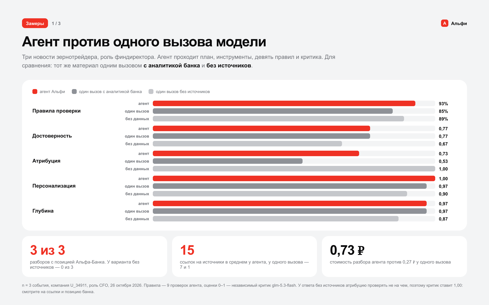
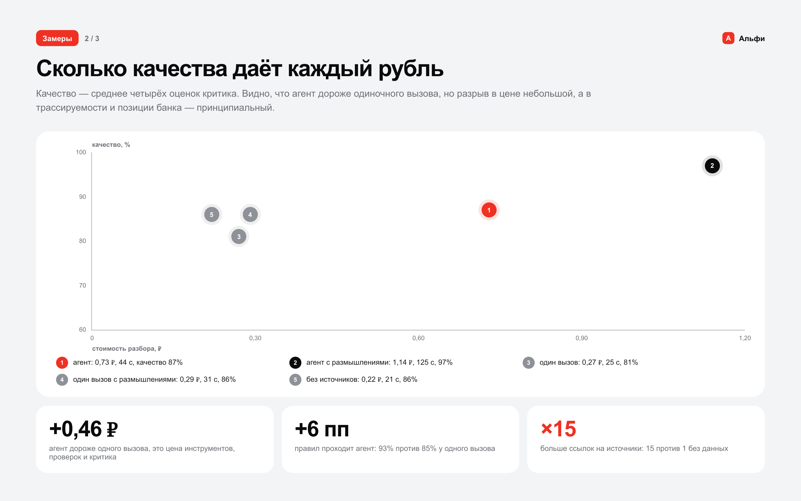
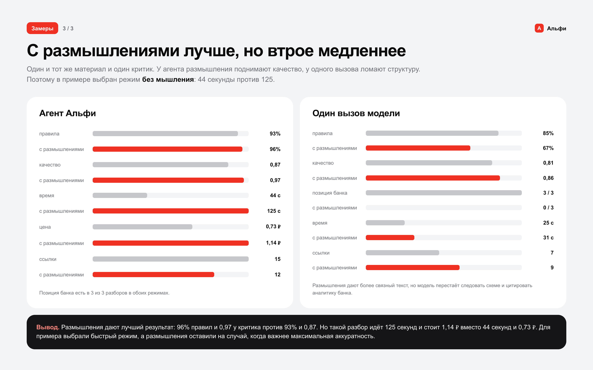

размышления дают лучший результат, но разбор идёт втрое дольше, поэтому в примере выбран режим без мышления. повторить: `cd server && uv run python -m scripts.bench --news 3`.

## настройки

`.env` в корне, его же читает compose.

| переменная | по умолчанию | что делает |
|---|---|---|
| `LLM_BASE_URL` | `https://api.alfahack-gateway26.ru/v1` | шлюз моделей |
| `LLM_API_KEY` | | ключ шлюза, обязателен |
| `EXA_API_KEY` | | ключ exa, без него только rss |
| `SESSION_SECRET` | `dev-secret-change-me` | подпись сессий, поменяйте |
| `SITE_PASSWORD` | | пароль на весь сайт; пусто — вход не нужен |
| `SITE_BASE` | | префикс, если приложение под путём: `/alfi` |
| `SITE_COOKIE_TTL_H` | `168` | сколько живёт вход, часов |
| `BUDGET_SOFT_RUB` / `BUDGET_HARD_RUB` | `120` / `450` | дневные пороги |
| `INGEST_INTERVAL_MIN` | `60` | автосбор, `0` выключает |
| `INGEST_USE_EXA` | `true` | искать через exa |
| `DATA_DIR`, `DB_PATH`, `KB_DIR`, `WEB_DIR` | `server/data/...` | пути |

## api

схема в [docs/api/openapi.json](docs/api/openapi.json), swagger на `/docs`. токен из `POST /api/session` в `Authorization: Bearer`.

| путь | что делает |
|---|---|
| `POST /api/session` | вход: компания и роль |
| `GET /api/feed`, `/api/profile` | лента и профиль |
| `GET/PUT/DELETE /api/team` | команда помощников |
| `GET /api/insight/{id}/stream` | разбор, SSE |
| `POST/GET/DELETE /api/chat` | чат с помощником |
| `POST /api/news/submit`, `/api/feedback` | своя новость, отклик |
| `GET /api/kb/docs`, `/api/kb/pdf/{id}` | аналитика банка |
| `GET /api/metrics` | качество и расходы |

> в демо вход открытый: выбрать можно любую компанию кейса. в проде токен выдаёт SSO, а демо-ручки закрываются.

## структура

```
server/app/      api, агент, инструменты, лента, профиль, команда, новости, поиск, защита
server/scripts/  bootstrap, build_db, ocr_pdfs, build_kb
server/tests/    быстрые тесты без сети
web/             index.html, css/, js/ (alfi.js, alfi-api.js, коты на webgl)
docs/            схемы, скриншоты, openapi
```

## тесты

```bash
cd server && uv run pytest
```

подпись сессий, маскировка пд, защита от инъекций, доступ по роли, json от модели, проверка цитат.

## ограничения

- новости только на русском и за 5 дней
- аналитика банка — 9 pdf кейса, по остальным темам раздел «альфа-банк» пустой
- данные кейса синтетические
- шрифт styrene лицензионный, без него системный гротеск

лицензии сторонних компонентов: [THIRD_PARTY_NOTICES.md](THIRD_PARTY_NOTICES.md)
