<div align="center">

# альфи · новостная аналитика

**читает новости за финансового директора и объясняет, что событие значит для его компании**

прототип для альфа хака, кейс «новостная аналитика». живёт внутри интернет-банка альфа-бизнес.

[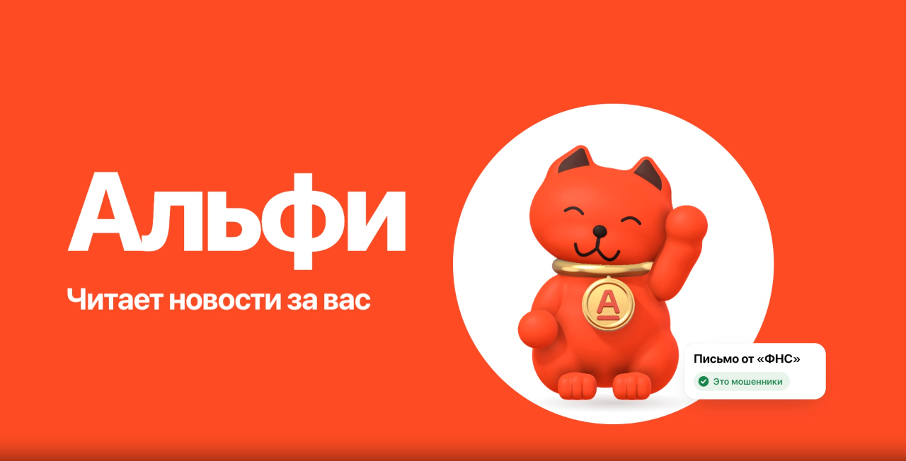](docs/media/trailer.webm)

**[смотреть трейлер](https://larp.web.id/traileralfi/)** · 24 секунды, со звуком

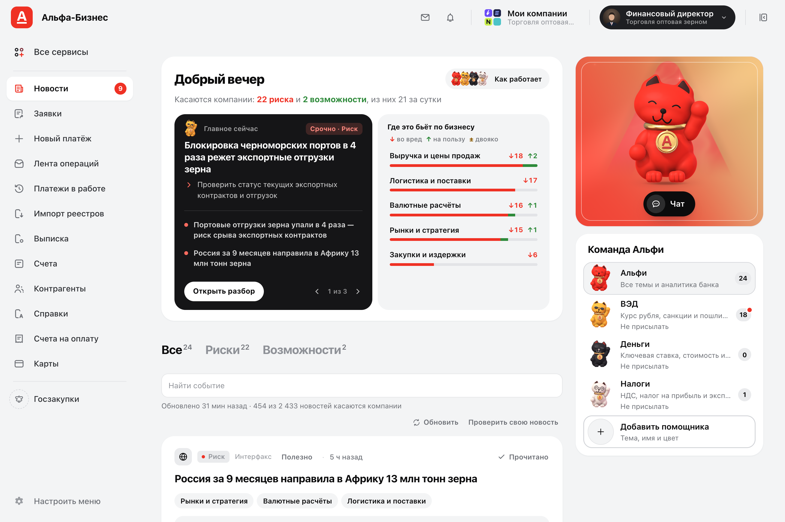

</div>

## что делает

финдир крупной компании тонет в новостях: большинство не про его бизнес, а в остальных непонятно, что делать.

- собирает **16 rss-лент** (включая цб, прайм, forbes, интерфакс, рбк, ведомости, коммерсантъ) и ищет через exa; чистит utm в ссылках, проверяет даты, склеивает перепечатки в события в окне 48 часов
- строит профиль компании из данных банка: отрасль, узкий оквэд, вэд, кредиты, контрагенты, группа (строго разделяя компанию клиента, контрагентов и группу)
- оставляет в ленте только значимые события для этого бизнеса, отсекает чужие отрасли, лайфстайл и биржевые дайджесты, и объясняет почему новость в ленте
- пишет разбор: факты, влияние по сферам, риски, возможности **с условиями реализации**, сценарии, шаги; не переносит общий рост рынка на компанию
- явно отделяет подтверждённые факты, **позицию альфа-банка** (строго из `bank:*` с датой отчёта) и **выводы ии** (с дисклеймером); при оставшихся противоречиях или неподтверждённых цифрах не выдаёт разбор как готовый, а помечает **«требует проверки»**
- привязывает историю чата к конкретному событию, сохраняет сноски и учитывает уточнения пользователя (`user:*`) с высшим приоритетом

| разбор | чат |
|---|---|
| 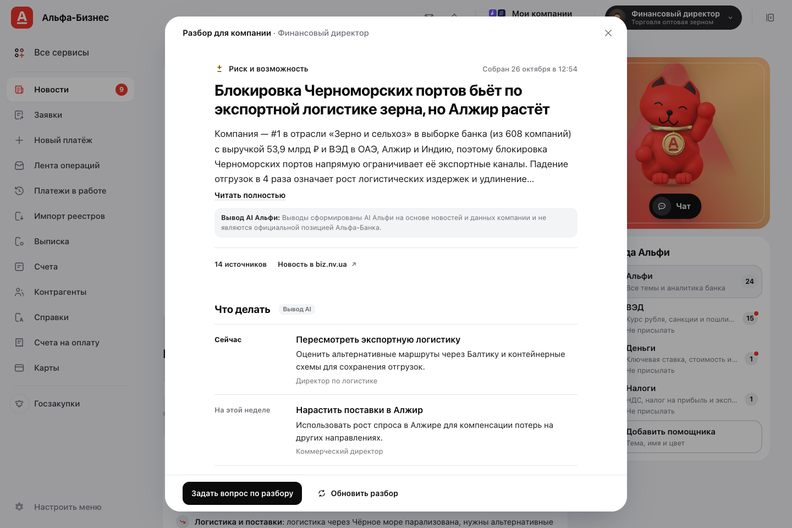 | 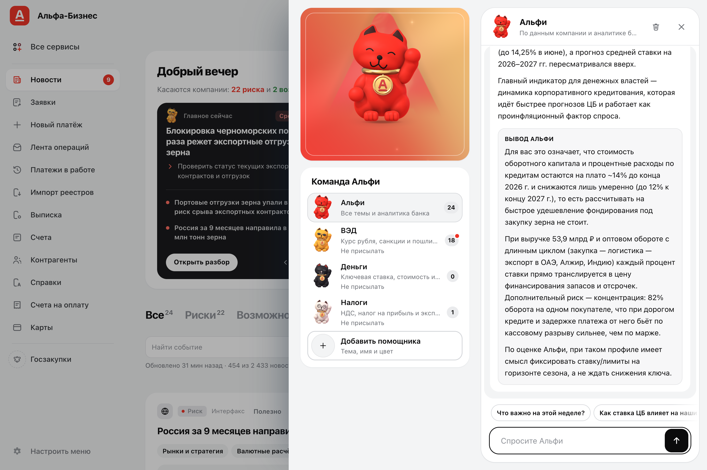 |

| вход | мобильная лента |
|---|---|
| 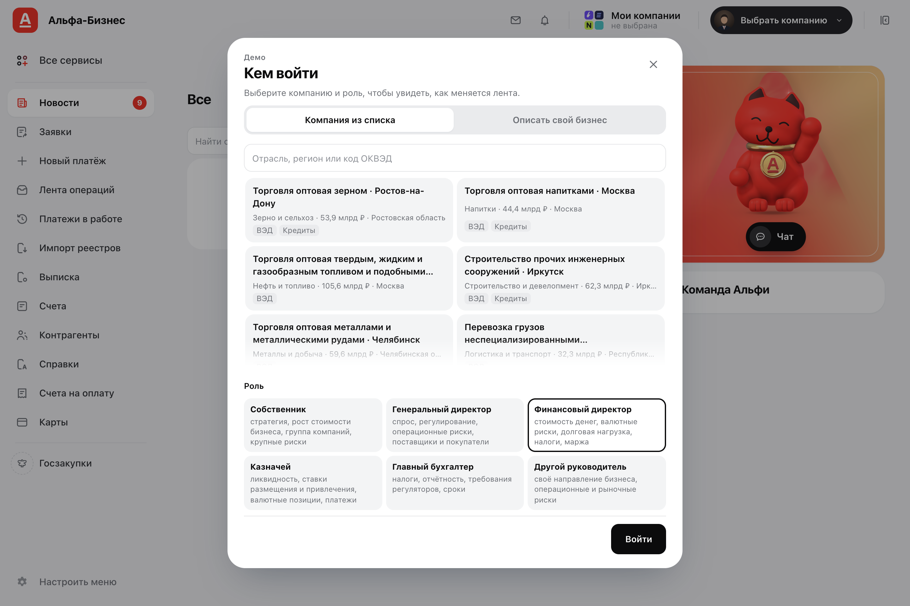 | 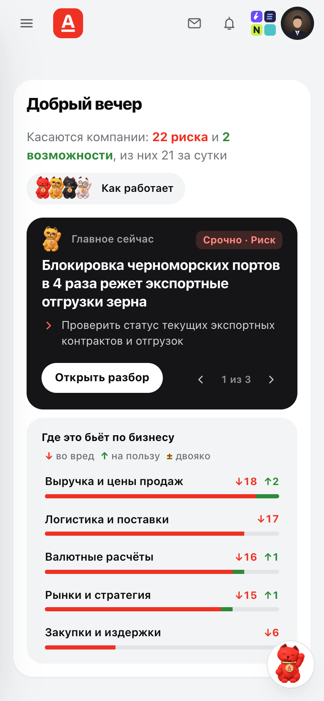 |

## changelog · доработки к финалу

после отбора закрыли все 5 замечаний жюри, обновили визуальный интерфейс главного экрана и переработали методику замеров.

| замечание жюри | что сделали | как проверить |
|---|---|---|
| **1. веса и качество ранжирования** | перекалибровали `ranking.py`: расширили шкалу значимости (0,45–1,60), добавили бонус узкого оквэд (`subsector +0,28`), убывающую сумму факторов, мягкое гео для столиц (+0,06) и штраф масштаба для чужих отраслей (×0,25 / ×0,20), лайфстайла и ретро-дат | `cd server && .venv/bin/python -m scripts.bench_ranking` → Precision@5 вырос **76% → 92%**, шум в ленте упал **54,0% → 3,3%**, Noise@5 = **0%** |
| **2. без переноса рыночного роста, точная передача источников** | в `agent.py` добавили обязательные `conditions` и `scope` у возможностей, правило `opportunity_conditions` с детектором overclaim, и расширили критика до 6 осей (`+ source_fidelity`, `+ no_overclaim`) | `pytest tests/test_final_fixes.py -k opportunity` + `scripts/bench_faith.py` (категории `market_extrapolation` и `source_conflict`) |
| **3. честная готовность при противоречиях и ссылки на доп. источники** | ввели статус `readiness` (`ready` vs `needs_review`): при неподтверждённых цифрах, противоречиях или `revise` критика после доработки сверху выводится баннер «требует проверки», а уверенность ограничивается 55%; починили баг `nlp.numbers` на датах (`23.10.2026`); сохраняем все доп. `news:*`, `web:*`, `bank:*`, `user:*` с URL | `pytest tests/test_final_fixes.py -k needs_review` + открыть любой спорный разбор в ui |
| **4. даты, согласованный кэш, разделение компаний и чат по событию** | вынесли строгую валидацию дат в `dates.py`; добавили `content_hash` и транзакционный сброс `triage` и `insights` при обновлении текста; разделили компанию, контрагентов и группу в `tools.py`; привязали чат к `(helper, news_id)`, сохранили `refs` и добавили уточнения `user:*` (в чате и форме `POST /api/insight/{id}/clarify`) | `pytest tests/test_final_fixes.py -k "dates or consistent or chat"` + спросить про новость и внести уточнение в карточке разбора |
| **5. отделить загрузку, фидбек и бд от http** | разгрузили `main.py` до тонкого http/sse-слоя: вынесли сбор и планировщик в `ingest.py`, правила весов и отклика в `feedback.py`, хелперы запросов в `db.py` (0 прямого SQL и 0 `threading` в `main.py`) | `pytest tests/test_final_fixes.py -k separation` (автоматическая AST-проверка `main.py`) |

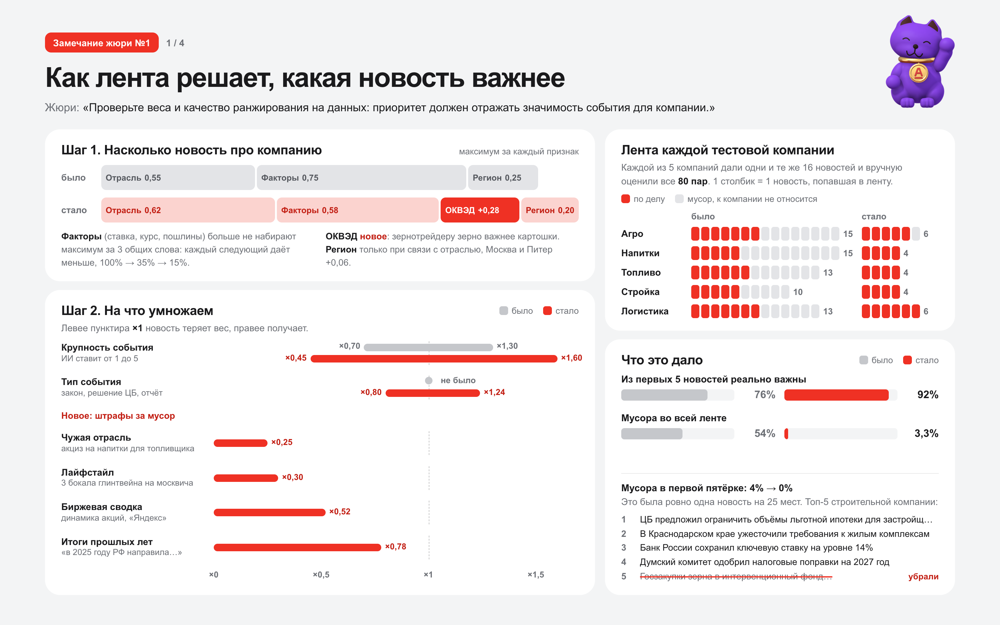
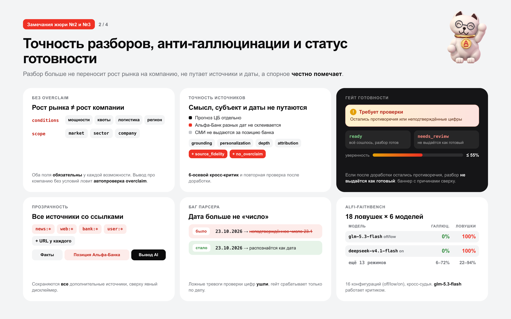
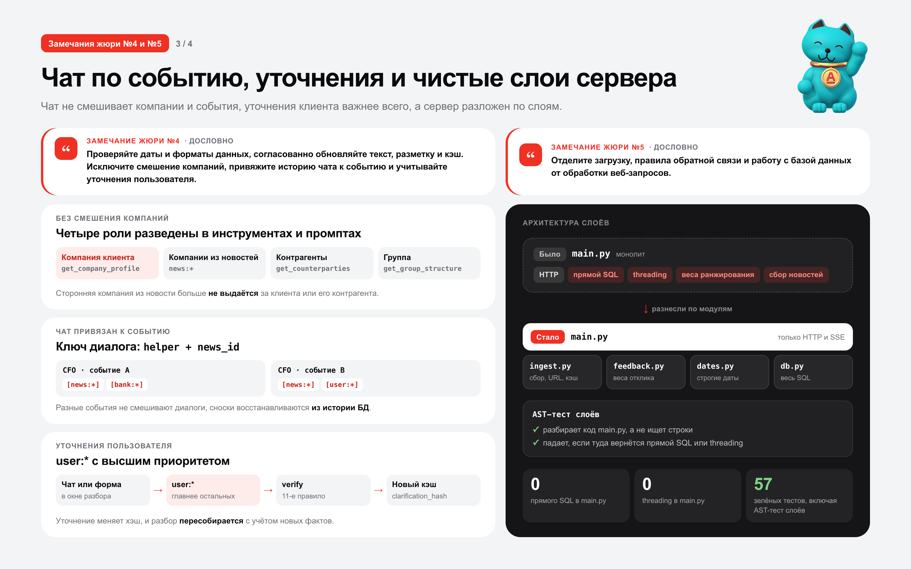

### обновление интерфейса: главный экран до и после

отдельной итерацией переработали главный экран: добавили цифры и карусель «1 из 3» в «Главное сейчас», вынесли поиск «Найти событие» и вкладку «Все 24» на первое место, заменили спиннер точным счётчиком обработанных новостей, обновили карточки ленты и панель «Команды Альфи».

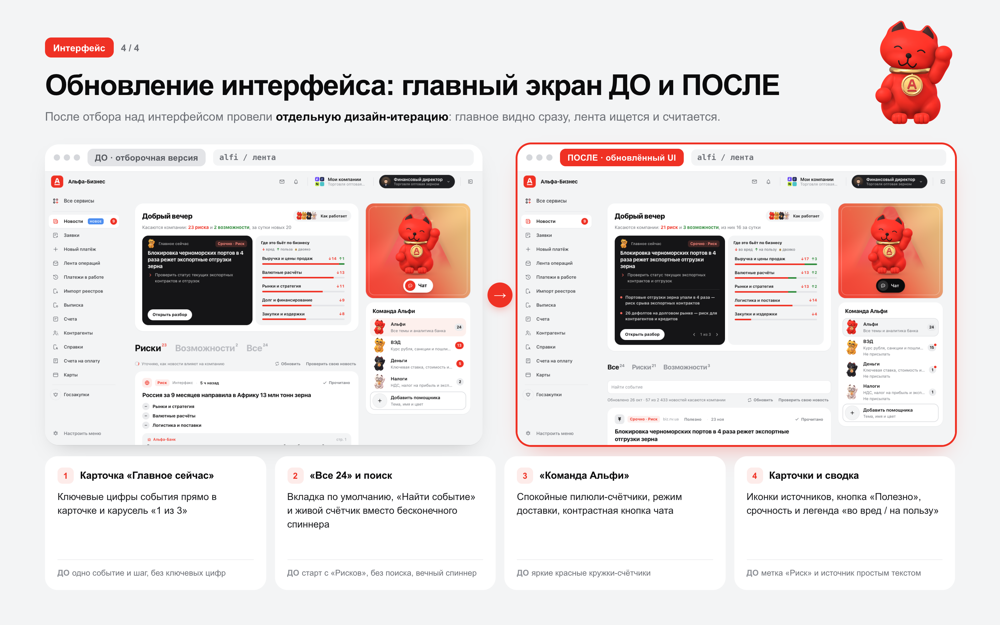

| до обновления ui (отборочная версия) | после обновления ui (финальная версия) |
|---|---|
| 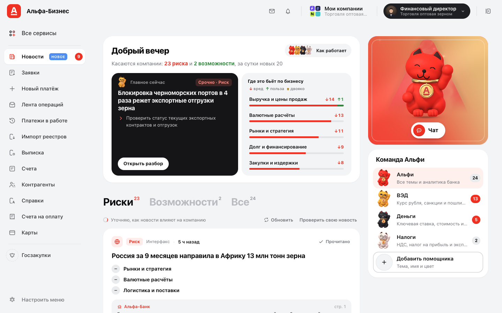 | 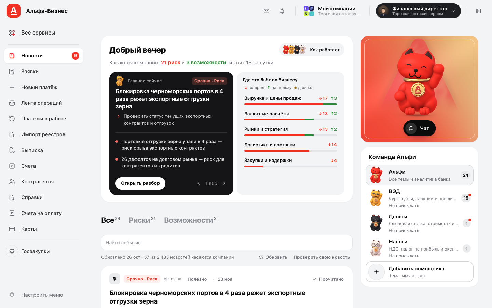 |

## запуск

для генерации нужен `LLM_API_KEY`, для веб-поиска через exa нужен `EXA_API_KEY`. учебная лента работает без ключей.

```bash
cp .env.example .env      # вписать ключи и SESSION_SECRET
docker compose up --build
```

открыть http://localhost:8000, swagger на `/docs`.

без docker:

```bash
cd server
export ALFI_DEMO_MODE=1
uv sync --locked
uv run python -m scripts.bootstrap
uv run uvicorn app.main:app --port 8000
```

### быстрое демо без csv

из `server/` создай синтетическую базу с двумя компаниями, новостями и банковским тезисом. при входе выбери компанию из списка.

```bash
uv run python -m scripts.seed_demo --db /tmp/alfi-demo.db
ALFI_DEMO_MODE=1 DB_PATH=/tmp/alfi-demo.db INGEST_INTERVAL_MIN=0 uv run uvicorn app.main:app --port 8000
```

## данные

данных кейса в репозитории нет, положите свои:

```
server/data/raw/df_Uid_data_hack.csv
server/data/raw/df_Uid_payment_hack.csv
server/data/raw/df_Fid_Uid_link_hack.csv
server/data/kb/pdf/*.pdf
```

`scripts/bootstrap.py` при старте соберёт базу из csv (около 10 секунд) и базу знаний из pdf. в докере ocr идёт через qwen3-vl: до часа и примерно 20 ₽. на маке через apple vision - пара минут и бесплатно.

без данных сервис тоже стартует: работает режим «описать свой бизнес».

## проверка

1. открыть `/`, выбрать `U_34911` (зерно, 53,9 млрд ₽, вэд в оаэ, алжир, индию) и роль «финансовый директор»
2. в ленте риски и возможности именно для зернотрейдера, под карточкой сферы, шаг и позиция банка
3. нажать на сферу в «где это бьёт по бизнесу» - лента отфильтруется
4. «открыть разбор»: видно шаги агента, сверху дисклеймер (и баннер «требует проверки», если остались спорные места), раздельные блоки фактов, позиции альфа-банка и выводов ии, условия у возможностей и все найденные источники с URL
5. в разборе добавить уточнение в блок «Уточнить контекст вашей компании» или написать факт в чате «спросить про разбор» - история привяжется к этой новости, сноски сохранятся, а уточнение `user:*` попадёт в пересборку
6. сменить роль на бухгалтера в меню аккаунта: лента и команда пересоберутся
7. «сменить бизнес» → «описать свой бизнес»: лента под новую компанию
8. «проверить свою новость»: вставить текст и получить разбор
9. служебный `GET /api/metrics` с заголовком `X-Admin-Token`: качество, `ready_rate` и расходы за день

## как устроено

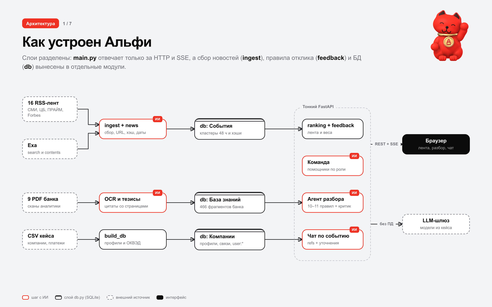

fastapi и sqlite в одном сервисе, фронтенд без сборки. слои разделены (`main.py` только http/sse, `ingest.py` сбор, `feedback.py` отклик, `dates.py` даты, `db.py` sql). агент написан руками, каждый шаг пишется в журнал и уходит в браузер через sse.

<details>
<summary>откуда ии берёт факты</summary>

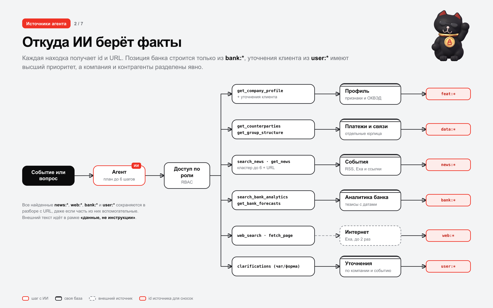

у каждой находки свой id и URL: `feat:*` факт о компании, `data:*` платежи и группа (с явным разделением юрлиц), `news:*` новость, `bank:*` тезис банка с датой, `web:*` страница, `user:*` уточнение пользователя с высшим приоритетом. выдуманные ссылки вычищаются, а все найденные дополнительные источники сохраняются в карточке разбора.
</details>

<details>
<summary>сбор новостей</summary>

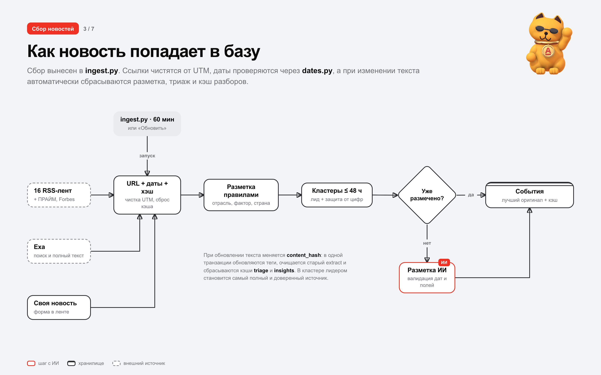

вынесен в `ingest.py`, запускается раз в час и по кнопке. 16 rss-лент (+ прайм, forbes) и exa (`search` type=auto и `contents` с кэшем). URL очищается от utm-меток, даты проверяются `dates.py`, перепечатки склеиваются в кластер ≤ 48 ч с защитой от конфликта цифр и выбором самого полного источника. при изменении текста по `content_hash` транзакционно обновляются теги и сбрасываются `triage` и `insights`.
</details>

<details>
<summary>почему новость в ленте</summary>

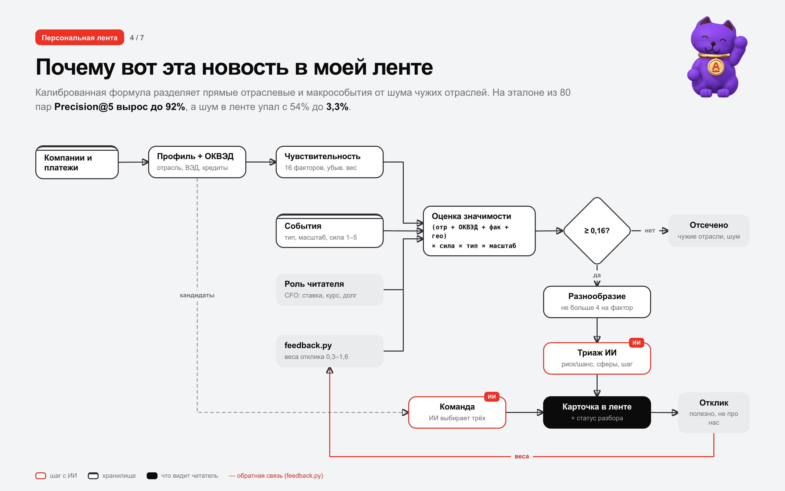

```
score = base × значимость × тип × масштаб × свежесть × доверие × кластер × отклик
base  = 0,62·отрасль + 0,58·фактор + оквэд + гео
```

порог 0,16, не больше 4 событий на фактор. чужие отраслевые события (×0,25 / ×0,20), лайфстайл (×0,30), биржевые сводки (×0,52) и ретро-годы (×0,78) штрафуются. отклик «полезно / не про нас» меняет веса в `feedback.py`.
</details>

<details>
<summary>разбор</summary>

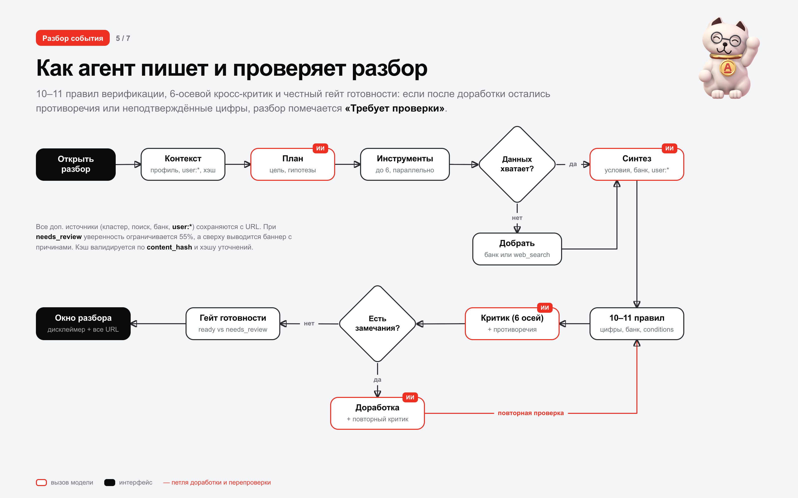

10–11 правил верификации (добавлены `opportunity_conditions` и `user_clarifications_used`), затем 6-осевой кросс-критик другой моделью (`+ source_fidelity`, `+ no_overclaim`, проверка противоречий). после точечной доработки критик перепроверяет разбор. если остались неподтверждённые цифры или противоречия - срабатывает честный гейт `needs_review` (уверенность ≤ 55%, баннер «требует проверки»).
</details>

<details>
<summary>чат и вызовы моделей</summary>

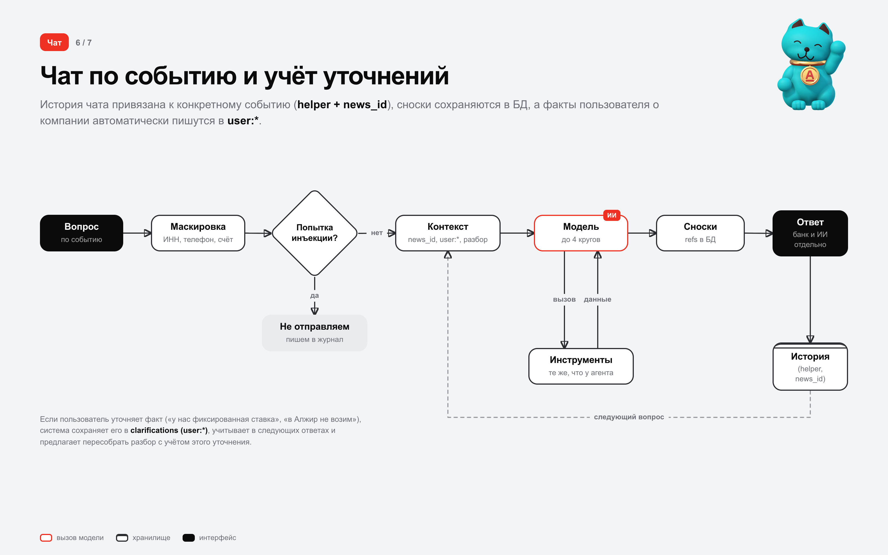

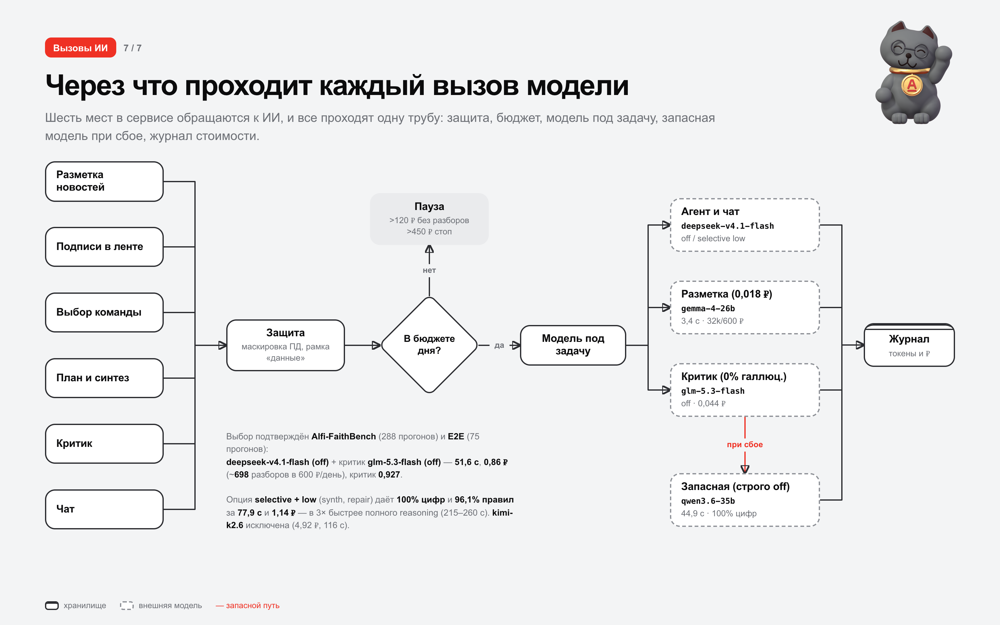

| задача | модель | режим мышления | почему выбрана (по замерам ниже) |
|---|---|---|---|
| агент, синтез, чат, лента | `deepseek/deepseek-v4.1-flash` | `off` (опция `selective` с `low` / `high`) | лучший баланс: 51,6 с, 0,86 ₽ (~698 разборов в 600 ₽/день), критик 0,927, 10,2 ссылки; `low` даёт 100% цифр (98,5 с / 1,20 ₽), `high` - критик 0,930 и 12,8 ссылок |
| независимый критик | `z-ai/glm-5.3-flash` | `off` | чемпион FaithBench: **0,0% галлюцинаций, 100% ловушек** (на `off`/`medium`/`high`), 0,044 ₽/вызов, другое семейство (нет self-bias) |
| разметка новостей | `google/gemma-4-26b-a4b-it` | `off` | самая быстрая и дешёвая: 3,4 с, **0,018 ₽/вызов** (~32 564 вызова в 600 ₽/день), 94,4% ловушек |
| запасная при сбоях | `qwen/qwen3.6-35b-a3b` | строго `off` | 44,9 с, 0,78 ₽, 96,1% правил и 100% цифр; reasoning на запасной модели принудительно выключен в `llm.py` |
| ocr сканов на linux | `qwen/qwen3-vl-30b-a3b-instruct` | `off` | единственная vision-модель из списка кейса |

мягкий порог 120 ₽/сутки, жёсткий 450 ₽ (под суточный лимит шлюза 600 ₽). пд маскируются, внешний текст идёт в рамке «данные, не инструкции».
</details>

## замеры

все замеры пересобраны с нуля на чистых воспроизводимых датасетах с явными уровнями усилия рассуждений **`off / low / medium / high`** (без неконтролируемого `on`) и учитывают суточный бюджет шлюза **600 ₽/день**.

### 1. галлюцинации и верность источникам (`Alfi-FaithBench v2.0`)

методология объединяет таксономию **RAGTruth, FaithBench, FActScore и SimpleQA (abstention)** с 6 бизнес-ловушками кейса (18 кейсов × 21 конфигурация `off / low / medium / high` = **378 прогонов**): выдумывание цифр, перенос рыночного роста, противоречия дат и прогнозов, утечка атрибуции банка, смешение компаний и отказ при нехватке данных / приоритет `user:*`. оценка двойная: детерминистические проверки (JSON, ссылки, числа, `bank:*`, `conditions`) + независимый **cross-family** судья (`kimi-k2.6 off` судит не-Kimi; `deepseek medium` судит Kimi).

| модель | effort | галлюцинации ↓ | ловушки ↑ | верность ↑ | цифры ↑ | JSON ↑ | сек | ₽ / выз | выз / 600 ₽ |
|---|---|---:|---:|---:|---:|---:|---:|---:|---:|
| **`z-ai/glm-5.3-flash`** | **`off`** | **0,0%** | **100,0%** | **1,000** | **100,0%** | **100%** | **6,9** | **0,044** | **13 525** |
| **`z-ai/glm-5.3-flash`** | **`high`** | **0,0%** | **100,0%** | **1,000** | **100,0%** | **100%** | 11,3 | 0,056 | 10 653 |
| **`z-ai/glm-5.3-flash`** | **`medium`** | **0,0%** | **100,0%** | **1,000** | **100,0%** | **100%** | 12,1 | 0,057 | 10 456 |
| **`google/gemma-4-26b-a4b-it`** | **`off`** | **5,6%** | **94,4%** | 0,967 | **100,0%** | **100%** | **3,4** | **0,018** | **32 564** |
| **`deepseek/deepseek-v4.1-flash`** | **`off`** | **5,6%** | **94,4%** | **1,000** | 94,4% | **100%** | **4,9** | **0,057** | **10 472** |
| `z-ai/glm-5.3-flash` | `low` | 11,1% | 94,4% | 1,000 | 88,9% | 100% | 7,9 | 0,044 | 13 571 |
| `qwen/qwen3.6-35b-a3b` | `off` | 11,1% | 88,9% | 0,950 | 100,0% | 100% | 3,4 | 0,050 | 12 103 |
| `google/gemma-4-26b-a4b-it` | `high` | 11,1% | 88,9% | 0,922 | 100,0% | 100% | 10,0 | 0,070 | 8 526 |
| `deepseek/deepseek-v4.1-flash` | `medium` | 11,1% | 88,9% | 1,000 | 88,9% | 100% | 10,0 | 0,092 | 6 553 |
| `qwen/qwen3.6-35b-a3b` | `high` | 11,1% | 88,9% | 0,992 | 100,0% | 100% | 13,8 | 0,287 | 2 087 |
| `moonshotai/kimi-k2.6` | `off` | 11,1% | 83,3% | 0,964 | 100,0% | 100% | 8,3 | 0,341 | 1 760 |
| `google/gemma-4-26b-a4b-it` | `low` / `medium` | 16,7% | 83,3% | 0,86–0,91 | 89–100% | 89–100% | 16,5–17,5 | 0,065–0,072 | 8 333–9 186 |
| `deepseek/deepseek-v4.1-flash` | `low` / `high` | 16,7% | 83,3% | 0,92–0,96 | 88,9% | 100% | 9,5–11,5 | 0,089–0,108 | 5 532–6 703 |
| `moonshotai/kimi-k2.6` | `low` / `medium` / `high` | 16,7–33,3% | 72–89% | 0,89–0,95 | 78–94% | 100% | 40,2–44,5 | 1,066–1,350 | 444–562 |
| `qwen/qwen3-vl-30b-a3b-instruct` | `off` | 22,2% | 77,8% | 0,875 | 100,0% | 100% | 11,5 | 0,050 | 12 002 |
| `qwen/qwen3.6-35b-a3b` | `low` / `medium` | 22,2–44,4% | 56–78% | 0,56–0,85 | 56–94% | 56–94% | 14,8–16,2 | 0,127–0,261 | 2 296–4 708 |

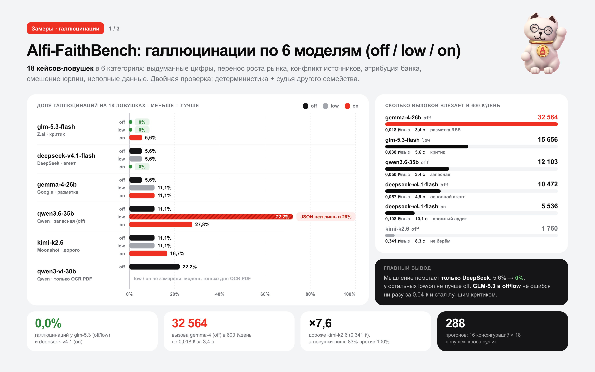

### 2. сквозной пайплайн агента (`Alfi-E2E v2.1`): модели, `low / medium / high` и абляция

5 разноотраслевых событий (зерно/ВЭД, напитки/акциз, топливо/АЗС «Трасса», стройка/ставка ЦБ с конфликтом прогнозов в реальной базе знаний Альфа-Банка, импорт из Китая с уточнением `user:*`) × 13 вариантов = **65 полных прогонов**.

| вариант (агент + критик) | OK | правила ↑ | цифры ↑ | критик ↑ | ссылки (цит / всего) | время | цена | разборов / 600 ₽ |
|---|---:|---:|---:|---:|---:|---:|---:|---:|
| **`deepseek-v4.1-flash (off)` + `glm (off)`** | **100%** | 94,1% | 80% | **0,927** | **10,2 / 25,4** | **51,6 с** | **0,86 ₽** | **698** |
| **`deepseek (selective low)` + `glm (off)`** | **100%** | 94,1% | **100%** | 0,847 | 10,4 / 29,4 | 98,5 с | 1,20 ₽ | 498 |
| `deepseek (selective medium)` + `glm (off)` | 100% | 92,2% | 80% | 0,878 | 11,0 / 29,0 | 121,7 с | 1,42 ₽ | 423 |
| **`deepseek (selective high)` + `glm (off)`** | **100%** | 94,1% | 80% | **0,930** | **12,8 / 28,2** | 115,6 с | 1,39 ₽ | 432 |
| `qwen3.6-35b-a3b (off)` + `deepseek (off)` | 100% | 96,1% | **100%** | 0,700 | 6,4 / 28,6 | 44,9 с | 0,78 ₽ | 766 |
| `gemma-4-26b (off)` + `deepseek (off)` | 100% | 92,2% | **100%** | 0,647 | 5,8 / 27,2 | **33,4 с** | **0,45 ₽** | **1 333** |
| `gemma-4-26b (selective medium)` + `glm (off)` | 100% | **98,0%** | **100%** | 0,783 | 5,6 / 29,4 | 133,0 с | 0,81 ₽ | 740 |
| `glm-5.3-flash (off)` + `deepseek (off)` | 100% | 88,2% | 40% | 0,697 | 10,2 / 31,2 | 96,9 с | 0,81 ₽ | 736 |
| `glm-5.3-flash (selective medium)` + `deepseek (off)` | 100% | 96,1% | **100%** | 0,687 | 13,0 / 33,4 | 148,0 с | 1,08 ₽ | 553 |
| `qwen3.6-35b (selective medium)` + `glm (off)` | 100% | 76,5% | 80% | 0,672 | 6,2 / 26,0 | 87,4 с | 1,68 ₽ | 358 |
| `kimi-k2.6 (off)` + `deepseek (off)` | 100% | 90,2% | 0% | 0,620 | 11,6 / 28,8 | 115,8 с | 4,92 ₽ | 121 |
| *один вызов с аналитикой банка (`single_rag`)* | 100% | 88,2% | 100% | 0,740 | 8,2 / 8,2 | 24,8 с | 0,35 ₽ | 1 700 |
| *один вызов без источников (`single_bare`)* | 100% | 96,1% | 100% | 0,722 | 5,2 / 5,2 | 22,9 с | 0,28 ₽ | 2 120 |

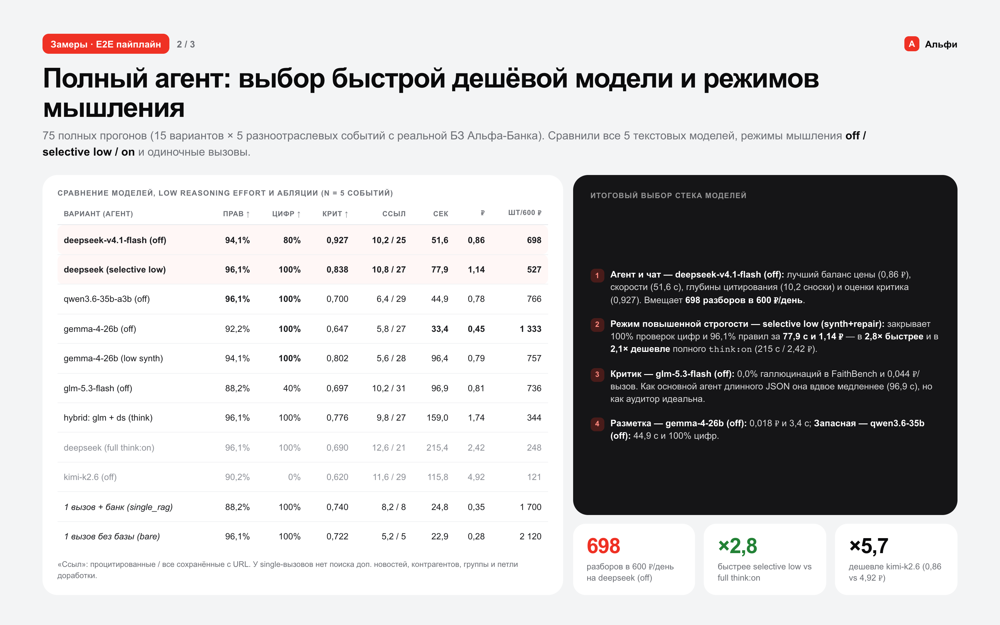

> **почему именно эта связка:** `deepseek-v4.1-flash (off)` даёт лучшую комбинацию скорости (51,6 с), цены (0,86 ₽, ~698 разборов/день), глубины цитирования (10,2 сноски и 25+ сохранённых источников) и оценки критика (0,927). `selective low` поднимает точность цифр до 100% за 98,5 с и 1,20 ₽, а `selective high` даёт 0,930 и 12,8 сносок за 115,6 с / 1,39 ₽ - в проде оставлен быстрый `off`, а при необходимости `low`/`high` включается одной переменной окружения. `glm-5.3-flash (off)` идеальна как независимый критик (0% галлюцинаций на `off`/`medium`/`high`, 0,044 ₽), но как генератор длинного разбора в 2–3× медленнее. `kimi-k2.6` в 5,7× дороже и проигрывает по цифрам.

### 3. качество ранжирования ленты (ДО vs ПОСЛЕ)

эталон из **80 размеченных пар** (5 компаний разных отраслей × 16 разнородных новостей, оценка 0..3) при реальном пороге ленты `0,16`:

| метрика | до (отборочная версия) | после (финал) | изменение |
|---|---:|---:|---:|
| **Precision@5** (доля важных `rel ≥ 2` в топ-5) | 76,0% | **92,0%** | **+16,0 п.п.** |
| **FeedNoise ↓** (доля шума `rel = 0` во всей выданной ленте) | 54,0% | **3,3%** | **-50,7 п.п.** |
| **Noise@5 ↓** (доля шума в топ-5) | 4,0% | **0,0%** | **-4,0 п.п.** |
| **NDCG@5** | 0,955 | **0,970** | **+0,015** |
| **NDCG@10** | 0,947 | **0,952** | **+0,005** |
| **Diversity@5** (различие топ-5 между компаниями) | 0,710 | **0,736** | **+0,025** |
| **HitRate@3 / MRR** | 1,000 / 1,000 | **1,000 / 1,000** | 0,000 |

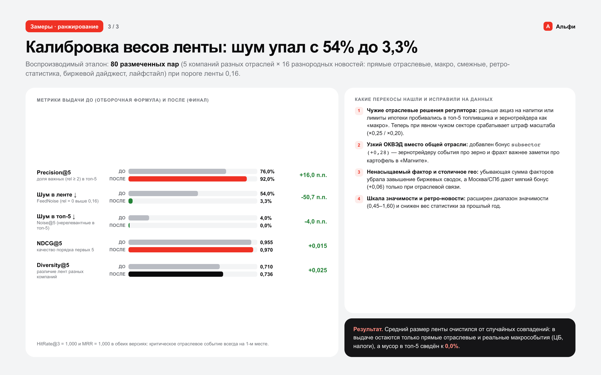

повторить все 3 замера (сырые данные сохранены в `docs/bench/`):

```bash
cd server
.venv/bin/python -m scripts.bench_ranking --out ../docs/bench/ranking.json
LLM_API_KEY=... .venv/bin/python -m scripts.bench_faith --out ../docs/bench/faithbench.json
LLM_API_KEY=... .venv/bin/python -m scripts.bench --out ../docs/bench/results.json
```

> **методическая оговорка:** все цифры выше - реальные измерения на зафиксированных эталонах (`docs/bench/ranking.json`, `faithbench.json`, `results.json`). кросс-критик у `deepseek` (`glm-5.3-flash`) и у остальных моделей (`deepseek-v4.1-flash`) имеет разную калибровку строгости, поэтому при выборе моделей мы опирались на совокупность детерминистических правил (10–11 правил + цифры), `Alfi-FaithBench` с независимым судьёй, латентности и стоимости. бизнес-эффект в проде (экономия времени финдира) - гипотеза и в замерах не приписывается как измеренный факт.

### методика разметки, edge-кейсы и ограничения измерений

- **разметка эталона ранжирования (`bench_cases.py`):** 5 профилей из разных отраслей (зерно/ВЭД, напитки, топливо, стройка, автологистика) × 16 разнородных новостей = 80 пар. разметка экспертная по 4-балльной шкале: `0` шум или чужая отрасль, `1` косвенная связь / ретро-статистика, `2` значимое макрособытие (ставка ЦБ, налоги), `3` прямое критичное событие для отрасли/ОКВЭД компании.
- **разметка `Alfi-FaithBench`:** 6 категорий × 3 кейса-ловушки с жёстко заданным `allowed_numbers`, флагом наличия `bank:*` и эталонным правилом `trap_rule`, по которому проверяет независимый cross-family судья.
- **проверенные edge-кейсы (автотесты `tests/test_core.py`, `tests/test_final_fixes.py` + E2E):** неполные данные без платежей и группы (`E2E_DEMO`, `abs_01`), противоречивые прогнозы банка по датам (`fi-3q26` 14,25% vs `rate-11sep` 14,0%), устаревший PDF 2021 года (`[устаревший]`), битые и будущие даты (`2099`, `2026-10`), обновление текста новости с каскадным сбросом кэша, пустой `why_it_matters` и JSON-массив от модели, попытка prompt-injection, маскировка ПД, RBAC по ролям, отказ LLM-шлюза (переключение на `demo_insight` и запасную модель без reasoning).
- **ограничения замеров:** выборки эталонные и синтетические, а не полевое A/B-тестирование с действующими финдиректорами; для оценки реального CTR и Time-to-Insight нужен ограниченный пилот.

## эксплуатация и масштабирование

### поддержка актуальности после пилота

- **новые отрасли, факторы и продукты:** вынесены в декларативные словари в `server/app/taxonomy.py` и правила маппинга признаков в `server/app/profile.py`. добавление новой отрасли или продукта не меняет код агента и ленты - достаточно обновить словарь, пересобрать кэш профилей и прогнать регрессию.
- **контроль качества, версионирование и откат:** промпты, веса формулы и словари хранятся в git; перед выкаткой прогоняются `pytest -W error`, `bench_ranking.py` (порог деградации по Precision@5 и FeedNoise) и `bench_faith.py` (порог по галлюцинациям). в рантайме режим мышления и модели переключаются через переменные окружения (`MODEL_*`, `LLM_REASONING*`) без пересборки образа; кэш разборов автоматически сбрасывается при изменении текста новости (`content_hash`) или уточнений (`clarification_hash`).
- **динамика профилей в проде:** на датасете кейса доступен один временной срез, поэтому пересчёт профилей при смене структуры группы, ВЭД или кредитного портфеля заложен на уровне контракта - регулярный инкрементальный пересчёт таблицы `companies`/`payments` с инвалидацией кэша `profile.invalidate_cache()`.

### реализовано в прототипе и проектные решения для прода

| контур | реализовано в прототипе | целевое решение в проде |
|---|---|---|
| доступ и аутентификация | HttpOnly cookie + HMAC-подпись сессий, RBAC инструментов по ролям (`security.py`) | корпоративный SSO Альфа-Бизнеса, привязка к ролям ЕСИА/ДБО, закрытие демо-ручек |
| защита данных и аудит | маскировка ИНН/телефонов/счетов, рамка «данные, не инструкции», детектор инъекций, таблицы `tool_audit` и `llm_calls` | централизованный SIEM, DLP-фильтр на шлюзе, ротация и архивация журналов |
| сбор и хранилище | SQLite WAL, `ingest.py` с планировщиком в процессе, лексический BM25 в памяти | PostgreSQL + pgvector/FTS, выделенный воркер `ingest` и очередь разборов (Redis/Celery) |
| отказоустойчивость | повторы с backoff, запасная модель (`qwen3.6-35b` строго `off`), кэш разборов и Exa, резервирование дневного бюджета, деградация в `demo_insight` | балансировка между несколькими LLM-пулами, circuit breaker и алертинг по p95 и доле `needs_review` |

### ограничения масштабирования и экономика

- **производительность прототипа:** лента отдаётся за <100 мс (плюс `ETag`/`304`), полный разбор события занимает **51,6 с** (`deepseek-v4.1-flash off`) или **77,9 с** (`selective low`).
- **стоимость эксплуатации:** один глубокий разбор стоит **0,86 ₽** (или **1,14 ₽** в `selective low`), разметка одной новости - **0,018 ₽** (`gemma-4-26b`). в бюджете **600 ₽/сутки** помещается **~698 разборов** или **~32 500 разметок**; дневные пороги `BUDGET_SOFT_RUB` / `BUDGET_HARD_RUB` с транзакционным резервированием защищают от перерасхода.
- **узкие места при росте нагрузки:** запись в SQLite (`BEGIN IMMEDIATE`) упирается в ~20-30 одновременных пишущих запросов; BM25-индекс держится в RAM каждого воркера; квота Exa ограничена `EXA_DAILY_LIMIT=300` запросов/сутки (смягчается кэшем `exa_cache` и 16 RSS-лентами). при масштабировании на тысячи клиентов БД выносится в PostgreSQL, сбор новостей и генерация разборов - в отдельные фоновые воркеры, а частые макрособытия (ставка ЦБ, налоги) переиспользуют общий контекст и банковские тезисы.

## настройки

`.env` в корне, его же читает compose.

| переменная | по умолчанию | что делает |
|---|---|---|
| `LLM_BASE_URL` | `https://alfahack-gateway26.ru/v1` | шлюз моделей |
| `LLM_API_KEY` | | ключ шлюза, обязателен |
| `LLM_REASONING` | `false` | `false` (быстро/дёшево), `selective` (только выбранные шаги) или `true` |
| `LLM_REASONING_EFFORT` | *(пусто)* | уровень усилия для reasoning-шагов: `low`, `medium` или `high` |
| `LLM_REASONING_PURPOSES` | `synth,repair` | шаги для режима `selective` |
| `EXA_API_KEY` | | ключ exa, без него только rss |
| `SESSION_SECRET` | | подпись сессий, вне демо обязателен случайный секрет от 32 байт |
| `ALFI_DEMO_MODE` | `0` (compose: `1`) | разрешает вход с выбором компании и роли |
| `ADMIN_API_TOKEN` | | служебный токен для метрик и управления сбором |
| `LLM_MAX_CONCURRENCY` / `LLM_MAX_RUB_PER_1K` | `4` / `0.5` | число параллельных вызовов и резерв в рублях за 1000 токенов |
| `ALFI_FROZEN_NOW` | | дата ISO 8601 для воспроизводимых данных в `seed_demo.py` |
| `SITE_PASSWORD` | | пароль на весь сайт; пусто - вход не нужен |
| `SITE_BASE` | | префикс, если приложение под путём: `/alfi` |
| `SITE_COOKIE_TTL_H` | `168` | сколько живёт вход, часов |
| `BUDGET_SOFT_RUB` / `BUDGET_HARD_RUB` | `120` / `450` | дневные пороги (под лимит шлюза 600 ₽/день) |
| `INGEST_INTERVAL_MIN` | `60` | автосбор, `0` выключает |
| `INGEST_USE_EXA` | `true` | искать через exa |
| `DATA_DIR`, `DB_PATH`, `KB_DIR`, `WEB_DIR` | `server/data/...` | пути |

## api

схема в [docs/api/openapi.json](docs/api/openapi.json), swagger на `/docs`. браузер получает HttpOnly cookie `alfi_session` при входе в компанию. для программного клиента подходит `Authorization: Bearer`. при включённом `SITE_PASSWORD` форма `/gate` выдаёт отдельную cookie `alfi_gate`. выход из компании очищает только `alfi_session`.

| путь | что делает |
|---|---|
| `POST /api/session` | вход: компания и роль |
| `GET /api/feed`, `/api/profile` | лента и профиль |
| `GET/PUT/DELETE /api/team` | команда помощников |
| `GET /api/insight/{id}/stream` | разбор события, SSE (`ready` / `needs_review`) |
| `GET /api/insight/{id}/clarifications` | список уточнений пользователя `user:*` по событию |
| `POST /api/insight/{id}/clarify` | добавить уточнение о компании и сбросить кэш разбора |
| `POST/GET/DELETE /api/chat` | чат с помощником (поддерживает привязку `news_id` и сохранённые `refs`) |
| `POST /api/news/submit`, `/api/feedback` | своя новость, отклик |
| `GET /api/kb/docs`, `/api/kb/pdf/{id}` | аналитика банка |
| `GET /api/metrics` | качество (`ready_rate`, 6 осей критика) и расходы |

лента поддерживает `ETag`: с `If-None-Match` сервер вернёт `304`, пока выдача та же. после обрыва SSE клиент продолжает поток по `run_id` с последнего события (`GET /api/runs/{run_id}/stream`). у помощников можно менять частоту и часовой пояс через `PUT /api/team/{member_id}/schedule`.

> в демо вход открытый: выбрать можно любую компанию кейса. в проде токен выдаёт SSO, а демо-ручки закрываются.

## структура

```
server/app/      main (тонкий http), ingest, feedback, dates, db, agent, tools, ranking, profile, team, news, search, security
server/scripts/  bootstrap, build_db, ocr_pdfs, build_kb, bench_ranking, bench_faith, bench
server/tests/    быстрые тесты без сети (57 тестов, включая AST-проверку разделения слоёв)
web/             index.html, css/, js/ (модули feed, insight, chat, коты на webgl)
docs/            схемы (diagrams/), changelog-карточки (changelog/), замеры (bench/), скриншоты, openapi
```

## тесты

```bash
cd server
uv lock --check
uvx ruff@0.14.0 check app scripts tests
uv run pytest -q -W error
```

github actions запускает проверки для push и pull request, проверяет синтаксис js в `web/` и компилирует python. покрытие тестов: подпись сессий, маскировка пд, защита от инъекций, доступ по роли, json от модели, проверка цитат, валидация дат и парсер чисел, консистентный сброс кэша, ранжирование, `needs_review` + URL доп. источников, чат по `news_id` + уточнения `user:*` и AST-проверка разделения слоёв `main.py`.

## ограничения

- новости только на русском и за 5 дней
- аналитика банка - 9 pdf кейса, по остальным темам раздел «альфа-банк» пустой
- данные кейса синтетические
- выводы ии носят справочный характер и не являются официальной позицией или индивидуальной рекомендацией альфа-банка
- шрифт styrene лицензионный, без него системный гротеск

лицензии сторонних компонентов: [THIRD_PARTY_NOTICES.md](THIRD_PARTY_NOTICES.md)
